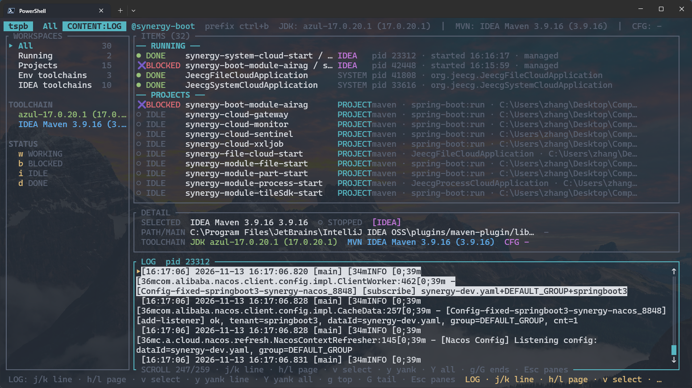

# tspb

**English** | [中文](README.zh-CN.md)


A terminal launcher for Spring Boot, written in Rust. It indexes your JDKs, Maven installs and launchable modules, starts one with a single key, and keeps the log right next to it — then gives the memory back when you quit.

The interaction model is deliberately terminal-native: one static binary, keyboard first, a **prefix key** that keeps TUI shortcuts away from the program inside the pane, grouped workspaces, status marks, a Goto picker, `/` filtering, mouse support, and detach that leaves your app running.



> Screenshot: WORKSPACES on the left, ITEMS (toolchains) in the middle, DETAIL and the live LIVE LOG below, current-layer key hints in the status bar.

## Scope: a low-memory "start it and watch the log" tool

**tspb is not a replacement for IntelliJ IDEA, VS Code, or any other IDE. Its goal is to cut memory usage in the cases where a full IDE is overkill.**

A resident full-featured IDE spends most of its memory on indexing, syntax trees, background compilation and a pile of always-on services — not on the few lines of business code you actually want to run. But plenty of moments don't need any of that:

- You changed one config value or one `@Value` and just want to restart and read the log;
- You run a gateway plus several services plus a scheduled job locally, with a run window per module open in the IDE, and memory is tight;
- You only want to watch logs or boot once more with another profile, without opening an IDE for one process;
- The machine is small (a modest laptop, with a browser, Docker and a database already running).

In those cases tspb is a single binary: no JVM, no indexing service, no background daemon — memory goes back the moment you quit. What it keeps is the part that is actually useful: **start a module, stream its log, do it from the keyboard**.

When you need to edit code, set breakpoints or refactor, go back to your IDE.

### What it does not do

| Not this | Detail |
| --- | --- |
| Edit code | No editor, completion, highlighting or refactoring |
| Debug | No breakpoints, variable inspection or expression evaluation |
| Reshape the build | No project generation, no `pom.xml` edits, no dependency downloads |

### What it does

| This | Detail |
| --- | --- |
| Index the environment | JDK / Maven (including IDEA's bundled JBR and Maven), running Spring Boot processes |
| Find launchable modules | Only modules with a `@SpringBootApplication` main class; parent / aggregator / api / biz modules are excluded |
| Launch with one key | Pick JDK, Maven and an IDEA run configuration; `Enter` runs `spring-boot:run` / `bootRun` |
| Stream logs | Ring buffer plus FOLLOW, scrollable, copyable (line / selection / all) |
| Manage lifetime | Stop, restart, detach, stop-all-and-quit; Windows kills the whole process tree |

## Install

Linux / macOS:

```bash
curl -fsSL https://raw.githubusercontent.com/OriginZero/tspb/main/install.sh | sh
```

Windows (PowerShell):

```powershell
irm https://raw.githubusercontent.com/OriginZero/tspb/main/install.ps1 | iex
```

The installer detects the platform and architecture, verifies the release checksum when the release ships `SHA256SUMS.txt`, installs into `~/.local/bin` (`%LOCALAPPDATA%\Programs\tspb` on Windows) and adds that directory to your `PATH` if it is missing.

Rather do it by hand? Every tag ships prebuilt binaries named `tspb-<tag>-<target>`:

| Platform | Target triple |
| --- | --- |
| Windows x86_64 | `x86_64-pc-windows-msvc` (`.zip`) |
| Linux x86_64 | `x86_64-unknown-linux-gnu` (`.tar.gz`) |
| Linux arm64 | `aarch64-unknown-linux-gnu` (`.tar.gz`) |
| macOS Apple silicon | `aarch64-apple-darwin` (`.tar.gz`) |
| macOS Intel | `x86_64-apple-darwin` (`.tar.gz`) |

Or build from source (Rust 1.88+):

```bash
cargo install --path .
```

## Quick start

Run it inside any Spring Boot repository — **no arguments needed**:

```bash
cd /path/to/your-spring-repo
tspb
```

It then:

1. **Indexes the environment** — JDK / Maven from environment variables, `PATH`, common install locations, IDEA's bundled JBR and Maven, and IDEA's `jdk.table.xml`; plus running Spring Boot Java processes.
2. **Locates the repository root** — walks up from the current directory to the `.git` root or the outermost Maven/Gradle aggregator pom. Run it from any submodule and the whole repository is still indexed.
3. **Picks the launchable items** — only modules with a `@SpringBootApplication` main class, excluding parent / aggregator / api / biz dependency modules; `<java.version>` is read to match a JDK, and IDEA run configurations under the repository root `.idea` are bound to their modules.
4. **Opens the TUI** — a two-layer Vim-style keyboard model: you start on the **PANES** layer with **nothing selected**; `h/j/k/l` picks WORKSPACES / ITEMS / LOG, `Enter` enters that window's **CONTENT** layer where `h/j/k/l` navigates inside the window, and `Esc` returns to PANES. Logs stream live in the LOG pane.

The `@<directory>` tag in the header is the repository root of this index, and the `PANES` / `CONTENT:ITEMS` label shows the current layer; the status bar lists the keys for that layer. If nothing launchable is found, it tells you to change directory or pass `--root`.

## What it scans

| Category | Sources |
| --- | --- |
| JDK / JRE | `JAVA_HOME`, `JDK_HOME`, `java` on `PATH`, `/usr/lib/jvm`, `%ProgramFiles%\Java`, `~/.sdkman`, `~/.jdks`, macOS `Contents/Home` |
| Maven | `MAVEN_HOME` / `M2_HOME` / `M3_HOME`, `mvn` on `PATH`, `/usr/share/maven`, `~/.sdkman` |
| IDEA bundled | `jbr` (JetBrains Runtime), `plugins/maven-plugin/lib/maven3` (older builds: `plugins/maven/lib/maven3`), JDKs registered in `jdk.table.xml` |
| Launch items | `pom.xml` / `build.gradle(.kts)` modules in the repository tree, `@SpringBootApplication` main classes, run configurations from `.idea/runConfigurations/*.xml` and `workspace.xml` |
| Running apps | Spring Boot Java processes (Maven embedder, Gradle daemon and IDEA itself are excluded) |

Versions are never obtained by running `java -version` / `mvn -v`: a JDK version comes from the standard `release` file, a Maven version from the `lib/maven-core-<ver>.jar` filename — fast and side-effect free.

**Multi-module and Spring Cloud specifics:**

- Run configurations often live in the **repository root** `.idea/workspace.xml` (as temporary `type="Application"` entries). The scanner walks up to four levels, binds each configuration to its module by `MAIN_CLASS_NAME`, and never mixes another module's configuration in.
- `<java.version>` / `<maven.compiler.release>` are read from the module pom and its parents, so the JDK whose major version matches is preferred; an explicit `preferred_jdk` or `--jdk` wins.
- Only modules with their own main class are listed. If a repository genuinely has none (Kotlin, generated sources, main class inside a dependency jar), it falls back to listing all Spring modules instead of showing an empty list.

## Build

```bash
cargo build --release
cd /path/to/your-spring-repo
path/to/tspb.exe          # Windows; tspb on Linux/macOS
```

Toolchain: `rust-toolchain.toml` only pins the `stable` channel and the `rustfmt` / `clippy` components, so every platform builds with its own host toolchain — plain `cargo build` works on Windows, Linux and macOS.

> Windows note: the default GNU toolchain (`stable-x86_64-pc-windows-gnu`) lacks `dlltool.exe` on some machines, and `windows-*` crates then fail to link with unresolved symbols. Pin MSVC for your checkout locally — **do not** commit a host-specific channel (it breaks clones on Linux/macOS):
>
> ```bash
> rustup override set stable-x86_64-pc-windows-msvc
> ```

## Command line (non-interactive)

| Flag | Purpose |
| --- | --- |
| `--scan-only` | Print scan root, JDKs / Maven / launch items / running apps — for troubleshooting |
| `--root DIR [DIR...]` | Index these trees instead of auto-locating from cwd |
| `--wide` | Global discovery: configured global roots plus IDEA recent projects (slower, many projects) |
| `--all-modules` | Also list non-launchable parent / library modules |
| `--max-depth N` | Project scan depth, default 6 (fits multi-module trees) |
| `--launch NAME` | Match one project by name / main class / path, start it, stream its log to stdout |
| `--watch-seconds N` | Observation window for `--launch`, default 90s; the process tree is stopped when it elapses or the app exits |
| `--detach` | Keep the `--launch` process running on exit |
| `--jdk SUBSTRING` | Force a JDK by name, overriding pom version matching |
| `--init-config` / `--help` | Write a default config / show help |
| `update` | Replace this binary with a release (`--version TAG`, `--mirror URL`) |

```bash
# Simplest use: go to the repo, open the TUI
cd /path/to/your-spring-repo && tspb

# See what this repository indexed
tspb --scan-only

# Start one module headlessly with live logs (process tree stopped on exit)
tspb --launch your-start-module --watch-seconds 180

# Keep it running: add --detach, or detach from the TUI with q
```

On failure, `--launch` also prints a `diagnosis` block that picks the real root cause out of the log (`Caused by:`, `CommunicationsException`, `BindException`, …) instead of Maven's generic help text.

## Updating

```bash
tspb update                        # latest release
tspb update --version v0.1.0       # reinstall a specific release
tspb update --mirror https://ghfast.top/   # same as TSPB_MIRROR=...
```

`update` asks the GitHub API for the latest tag, downloads the archive for your target triple, verifies it against the release `SHA256SUMS.txt` when present, and replaces the running binary (on Windows the old one is parked as `tspb.exe.old` until the next update).

**Mirrors:** by default the direct `github.com` URL is tried first, then each public mirror in `update.rs` (`MIRRORS`) is used as a fallback — handy when GitHub is slow or blocked. Set `TSPB_MIRROR` (or `--mirror`) to pin a single prefix instead; the value is prepended to the real URL verbatim, e.g. `https://ghfast.top/`. `install.sh` and `install.ps1` use the same fallback order.

## Verification

The repository ships automated tests and static checks covering environment scanning, repository-root resolution from cwd, launch-item filtering and the fallback, multi-module IDEA configuration binding, key-event de-duplication, Vim layer navigation, log copy ranges and scrollbar rendering, rendering in every mode, and real process start / log capture / process-tree stop:

```bash
cargo test
cargo clippy --all-targets
cargo build --release
```

CI (`.github/workflows/ci.yml`) runs the same three steps on Windows, macOS and Linux.

`--scan-only` output looks like this; the numbers and paths depend on your machine:

```text
JDK <n> | Maven <n> | Projects <n> | Running <n>
scan roots: <repository root that was indexed>
```

`--launch NAME --watch-seconds N` starts a single module headlessly, streams its log, and cleans up the process tree when the window ends or the app exits — handy for reproducing a failure.

### Startup progress

Scanning IDEA installs, many JDKs/Mavens and a deep multi-module tree can take a few seconds, so the UI opens immediately and shows a progress screen instead of a silently blocked terminal:

- one stage per category, ticked off as the scan advances: `idea → toolchains → projects → processes`;
- a gauge plus a live counter (JDKs / Maven / projects / directories visited) and the directory currently being walked;
- `Esc` (or `q` / `ctrl+c`) aborts before anything is launched.

The scan runs on a worker thread; the TUI is swapped in as soon as the inventory is ready. `--scan-only` / `--launch` skip the splash and scan synchronously.

## Interaction (two-layer Vim model)

> One key press produces exactly one action: Windows terminals report both key-down and key-up for every press, and enhanced terminals add auto-repeat on long presses. Those phantom events are dropped before the state machine, so `j/k` never skips two rows, `/` filtering never doubles characters, and `Enter` never starts two processes. Releasing `ctrl+b` does not cancel the prefix you just pressed.

### PANES layer (the default)

**Nothing is selected on startup**: WORKSPACES / ITEMS / LOG all have dim borders and no list row is highlighted. Use `h/j/k/l` (or the arrow keys) to pick a window — the chosen border turns yellow and shows `[Enter]` — then press `Enter`.

| Key | Action |
| --- | --- |
| `h` / `←` | Select WORKSPACES on the left |
| `l` / `→` | Select ITEMS |
| `j` / `↓` | Select LOG below |
| `k` / `↑` | Select ITEMS above |
| `Enter` | Enter the selected window (ITEMS if nothing was picked yet) |
| `Esc` | Clear filter / status filter / zoom / toast message |
| `?` / `r` / `q` / `Q` | Help / rescan / detach / stop everything and quit |

### CONTENT layer (inside a window)

Once a window is active, the same `h/j/k/l` only act **inside that window**; the header shows `CONTENT:ITEMS` and the status bar switches to that window's keys.

| Window | Key | Action |
| --- | --- | --- |
| ITEMS | `j/k` | Move the selection |
| ITEMS | `h/l` | Previous / next workspace |
| ITEMS | `Enter` | Launch, attach to a running app's log, or set the default JDK / Maven |
| WORKSPACES | `j/k/h/l` | Switch workspace (All / Running / Projects / toolchain views) |
| LOG | `j/k` | Move the log line cursor |
| LOG | `h/l` | Page up / page down |
| Any | `Esc` | Back to PANES (cancels the visual selection first) |

### LOG: copy, line selection, scrollbar

The LOG pane opens in `SCROLL` mode; the scrollbar on the right shows where the line cursor sits in the whole log, and the reverse-video line is what `y` copies.

| Key | Action |
| --- | --- |
| `y` | Copy the current line to the system clipboard |
| `v` | Enter `VISUAL` line selection, extend with `j/k`, then `y` to copy the range |
| `Y` | Copy the whole log |
| `g` / `G` / `End` / `F` | First line / back to the live tail / back to the live tail |
| `Esc` | Cancel VISUAL, or return to PANES |

Copying uses the system clipboard (an X11 session keeps the clipboard owner until the program exits). When no clipboard is available (remote or headless session) the text is written to `tspb-clipboard.txt` in the temp directory and the path is shown in the status bar, so nothing is lost. The mouse wheel scrolls the LOG pane, and clicking any window enters its CONTENT layer directly.

### Prefix (default `ctrl+b`)

Press the prefix, release it, then press a key — that key belongs to the TUI and never reaches the process inside the log pane. In this model, prefix window jumps go **straight into** the target window's CONTENT layer.

| Key | Action |
| --- | --- |
| `prefix ?` | Toggle the key help |
| `prefix q` | **Detach**: leave the TUI, apps keep running in the background |
| `prefix Q` | Stop every app started by this TUI, then quit (asks first) |
| `prefix g` | Goto picker: grouped jump list, type to search |
| `prefix h/l/j`, `prefix 1/2/3` | Jump into WORKSPACES / ITEMS / LOG CONTENT |
| `prefix v` or `prefix -` | Split / toggle the live log pane |
| `prefix x` | Close the log pane |
| `prefix z` | Zoom the current pane |
| `prefix b` | Show / hide the sidebar |
| `prefix w/n/p` | Switch workspace (All / Running / Projects / Env toolchains / IDEA toolchains) |
| `prefix r` | Rescan all four categories |
| `prefix [` | Jump into LOG scroll / copy mode |

### Other direct keys (global / ITEMS)

| Key | Action |
| --- | --- |
| `/` | Type a filter (arrow keys move the caret, `Enter` / `Esc` finishes) |
| `w` `b` `i` `d` `a` | Filter by `WORKING` / `BLOCKED` / `IDLE` / `DONE`; `a` shows everything |
| `s` / `R` | Stop / restart the selected app (stopping an external process asks first) |
| `J` / `M` / `c` / `Tab` | Pick JDK / Maven / IDEA run configuration / cycle configurations |
| `r` / `?` | Rescan / help |
| `g` | Goto picker (in the LOG pane it jumps to the first line) |
| `q` / `Q` / `Ctrl+C` | Detach / stop everything and quit / quit |

Status marks: `● DONE` running, `◐ WORKING` starting, `✖ BLOCKED` failed, `○ IDLE` not started, `⊘ EXITED` exited.

## Launching an app

1. Run `tspb` in the project directory. You start on PANES with nothing selected; press `l` (or `k`) to pick ITEMS, then `Enter` to enter its CONTENT layer.
2. Move with `j/k` or narrow with `/` (the list starts on the first launch item of the `PROJECTS` group); `J` / `M` switch JDK and Maven, `c` or `Tab` picks an IDEA run configuration (falling back to a generated `spring-boot:run` / `bootRun`).
3. Press `Enter`; tspb runs the following in the module directory (`.cmd` files are wrapped with `cmd.exe /C` on Windows):

```
mvn.cmd spring-boot:run \
  -Dspring-boot.run.main-class=<main class from the IDEA config> \
  -Dspring-boot.run.profiles=... \
  -Dspring-boot.run.jvmArguments=... \
  -Dspring-boot.run.arguments=...
```

A `mvnw` / `mvnw.cmd` wrapper in the project wins over a global Maven. Before launching it injects `JAVA_HOME`, prepends `<jdk>/bin` to `PATH`, sets `MAVEN_HOME` / `M2_HOME`, and strips inherited `JAVA_TOOL_OPTIONS` / `_JAVA_OPTIONS`. If the pom declares `<java.version>`, the JDK with that major version is preferred.

4. After launch the LOG CONTENT layer opens in `FOLLOW` mode; stdout/stderr stream through a pipe into a bounded ring buffer, and `Started ... in ... seconds` flips the status from `WORKING` to `DONE`. Use `j/k` to scroll back, `y` to copy a line, `v` + `j/k` + `y` to copy a range, `Y` for everything, `G` to return to the live tail.
5. `s` stops, `R` restarts, `q` detaches. After detaching the log reader still holds the pipe, so the child process is not interrupted by a closed pipe.

## Configuration

`tspb --init-config` prints the config path (Windows: `%APPDATA%\tspb\config.toml`). See [`config.example.toml`](./config.example.toml):

| Field | Meaning |
| --- | --- |
| `scan_roots` | Project roots to index; **empty (default) = auto-detect the repository containing cwd**. Explicit paths ignore cwd |
| `max_depth` | Maximum directory depth, default 6 |
| `strict_roots` | Default true: index only `scan_roots` / cwd, never IDEA's recent projects; `--wide` sets it false |
| `launchable_only` | Default true: list only launchable modules; `--all-modules` is equivalent to false |
| `prefix` | Prefix key, e.g. `ctrl+a` |
| `preferred_jdk` / `preferred_maven` | Default toolchain (substring match on the name); unset means match the pom's java.version |
| `extra_args` | Arguments appended to every launch |
| `log_capacity` / `tick_ms` | Log buffer lines / redraw interval |
| `skip_jbr` | Exclude IDEA's bundled JBR |

## Known limitations

- **Logs of external processes cannot be captured**: a JVM started by IDEA or from a shell owns its own console, so the TUI only shows its command line. Stop it with `s`, or select the project and let the TUI start it to get live logs.
- **External dependencies are yours to provide**: databases, Redis, Nacos, service registries and so on are decided by the project's configuration. tspb only starts the process with the selected JDK / Maven and shows its log; it does not check whether those dependencies are up.
- On Windows, stopping uses `taskkill /PID /T /F`, which force-kills the whole process tree; on Unix `SIGTERM` goes to the process group.
- Maven output in the system GBK encoding may look garbled; add `-Dfile.encoding=UTF-8` to `extra_args`, or configure UTF-8 logging in Spring Boot.
- Gradle projects get basic detection and `bootRun`; parsing of IDEA Gradle run configurations is simpler than for Maven.
- Project scans are capped at 400 entries; for large monorepos lower `max_depth` or narrow the scope with `--root`.
- The process list refreshes every 3 seconds (projects are not re-scanned); use `r` for a full rescan.

## Code layout

```
src/
├── main.rs           CLI (incl. --launch smoke mode), raw mode, event loop, panic recovery
├── app.rs            State machine: view/focus/filter/prefix/picker/confirm, JDK version matching
├── event.rs          Key translation (prefix state machine + direct keys + mouse)
├── ui.rs             ratatui rendering: sidebar / list / detail / log pane / overlays
├── progress.rs       Startup scan progress: shared state, staged gauge, splash screen
├── runner.rs         Process start, stop, log capture, detach
├── config.rs         TOML config, cwd repository-root resolution, global roots
├── model.rs          Data structures and state enums
├── scan/
│   ├── env.rs        Environment variables / PATH / install directories
│   ├── idea.rs       IDEA install, bundled JBR/Maven, XML configs
│   ├── project.rs    Repository root, launchable filter, main class, java.version, IDEA run configs
│   └── process.rs    Running Spring Boot processes
├── clipboard.rs      System clipboard with temp-file fallback
├── update.rs         tspb update: GitHub release download, checksum, binary replace
└── tests.rs          24 tests (real process start/log/stop, Vim layers, log copy, rendering, cwd resolution, key de-duplication, startup progress)
```

## Contributing

```bash
cargo fmt --all
cargo clippy --all-targets
cargo test
```

Make these three pass locally before opening a PR; CI runs them again on all three platforms. If you change key bindings or layout, update the key tables in both `README.md` and `README.zh-CN.md`.

## License

[MIT](./LICENSE)
