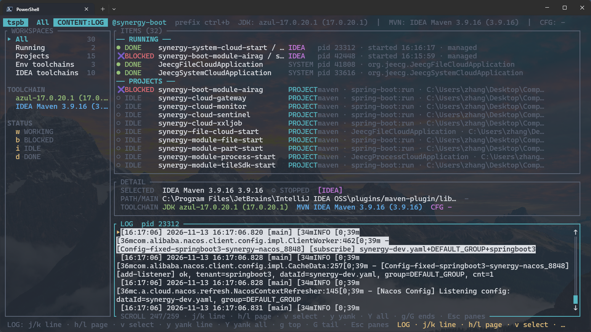

# tspb

[English](README.md) | **中文**


用 Rust 写的 Spring Boot 终端启动器。在仓库里索引 JDK / Maven / 可启动模块，一个键拉起进程，日志就在旁边，退出即释放内存。

交互模型是终端原生的：单二进制、键盘优先、**prefix 键**把快捷键和 pane 里的程序隔离开、分组 workspace、状态标记、Goto picker、`/` 过滤、鼠标可用、detach 后进程继续运行。



> 截图：左侧 WORKSPACES 视图、中间 ITEMS（工具链列表）、下方 DETAIL 与实时 LIVE LOG，底部状态栏给出当前层键位。

## 定位：省内存的「启动 + 看日志」工具

**tspb 不是 IDEA、VS Code 或任何 IDE 的替代品，目标是部分场景下减少内存开支。**

一个常驻的全功能 IDE，内存大头是索引、语法树、后台编译和一堆一直开着的服务，而不是你要跑的那几行业务代码。但很多时候你根本不需要这些能力：

- 只改了一个配置项或一行 `@Value`，想重启服务看日志；
- 本地要同时跑网关 + 多个服务 + 定时任务，IDE 里挂着好几个运行窗口，内存吃紧；
- 只想看日志、换个 profile 再起一次，不想为一个进程开整个 IDE；
- 机器内存有限（低配笔记本、同时开着浏览器 / Docker / 数据库）。

这些场景里，tspb 是一个单文件二进制：没有 JVM、没有索引服务、没有常驻后台，退出即释放，同时保留真正用得上的三件事——**按模块启动、实时日志、快捷键**。

需要写代码、断点调试、重构的时候，回 IDE 就好。

### 它不做什么

| 不做 | 说明 |
| --- | --- |
| 编辑代码 | 没有编辑器、补全、语法高亮、重构 |
| 调试 | 没有断点、变量查看、条件求值 |
| 改造工程 | 不生成工程、不改 `pom.xml`、不下载依赖 |

### 它做什么

| 做 | 说明 |
| --- | --- |
| 索引环境 | JDK / Maven（含 IDEA 内置 JBR 与 Maven）、运行中的 Spring Boot 进程 |
| 挑出可启动模块 | 只列含 `@SpringBootApplication` 主类的模块，自动排除 parent / aggregator / api / biz |
| 一键启动 | 选 JDK、选 Maven、选 IDEA run configuration，`Enter` 拉起 `spring-boot:run` / `bootRun` |
| 实时日志 | ring buffer + FOLLOW，可滚动、可复制（行 / 选区 / 全部） |
| 生命周期 | 停止 / 重启 / detach / 停止全部退出，Windows 杀整棵进程树 |

## 安装

Linux / macOS：

```bash
curl -fsSL https://raw.githubusercontent.com/OriginZero/tspb/main/install.sh | sh
```

Windows（PowerShell）：

```powershell
irm https://raw.githubusercontent.com/OriginZero/tspb/main/install.ps1 | iex
```

安装脚本会检测平台与架构，release 带 `SHA256SUMS.txt` 时校验哈希，装到 `~/.local/bin`（Windows 为 `%LOCALAPPDATA%\Programs\tspb`），该目录不在 `PATH` 里时会自动加上。

想手动安装也行，每个 tag 都会附带按 `tspb-<tag>-<target>` 命名的预编译包：

| 平台 | target |
| --- | --- |
| Windows x86_64 | `x86_64-pc-windows-msvc`（`.zip`） |
| Linux x86_64 | `x86_64-unknown-linux-gnu`（`.tar.gz`） |
| Linux arm64 | `aarch64-unknown-linux-gnu`（`.tar.gz`） |
| macOS Apple silicon | `aarch64-apple-darwin`（`.tar.gz`） |
| macOS Intel | `x86_64-apple-darwin`（`.tar.gz`） |

从源码安装（需要 Rust 1.88+）：

```bash
cargo install --path .
```

## 快速开始

在任意 Spring Boot 仓库里直接执行，**不需要任何参数**：

```bash
cd /path/to/your-spring-repo
tspb
```

程序会依次：

1. **索引环境** — 扫描 JDK / Maven（环境变量、PATH、常见安装目录、IDEA 内置 JBR 与 Maven、IDEA `jdk.table.xml`），以及正在运行的 Spring Boot Java 进程。
2. **定位仓库根** — 从当前目录向上回溯到 `.git` 根目录或最外层的 Maven/Gradle 聚合 pom；在任意子模块目录里执行，索引范围仍是整个仓库。
3. **挑出可启动项** — 只列出含 `@SpringBootApplication` 主类的模块，自动排除 parent / aggregator / api / biz 这类不能启动的依赖模块；读取 `<java.version>` 匹配 JDK，绑定仓库根 `.idea` 里的 IDEA 启动配置。
4. **进入 TUI 选择启动** — 采用 Vim 式两层键盘模型：默认停在 **PANES** 层，**不选中任何窗口**；`h/j/k/l` 选择 WORKSPACES / ITEMS / LOG，`Enter` 进入该窗口的 **CONTENT** 层，窗口内再用 `h/j/k/l` 导航，`Esc` 退回 PANES。日志实时显示在 LOG 窗口。

顶部标题栏的 `@<目录名>` 是本次索引的仓库根，`PANES` / `CONTENT:ITEMS` 标签显示当前所在的层；状态栏给出当前层的键位提示。若一个启动项都没找到，会提示换目录或用 `--root`。

## 它扫什么

| 类别 | 来源 |
| --- | --- |
| JDK / JRE | `JAVA_HOME`、`JDK_HOME`、`PATH` 中的 java、`/usr/lib/jvm`、`%ProgramFiles%\Java`、`~/.sdkman`、`~/.jdks`、macOS `Contents/Home` |
| Maven | `MAVEN_HOME`/`M2_HOME`/`M3_HOME`、`PATH` 中的 mvn、`/usr/share/maven`、`~/.sdkman` |
| IDEA 内置 | 安装目录下的 `jbr`（JetBrains Runtime）、`plugins/maven-plugin/lib/maven3`（老版本 `plugins/maven/lib/maven3`）、`jdk.table.xml` 中登记的 JDK |
| Spring Boot 启动项 | 当前仓库树下的 `pom.xml` / `build.gradle(.kts)` 模块、`@SpringBootApplication` 主类、仓库根 `.idea/runConfigurations/*.xml` 与 `workspace.xml` 中的启动项 |
| 运行中的应用 | Spring Boot Java 进程（自动排除 Maven embedder、Gradle daemon、IDEA 自身） |

版本不通过执行 `java -version` / `mvn -v` 获取：JDK 读标准 `release` 文件，Maven 读 `lib/maven-core-<ver>.jar` 文件名，扫描快且无副作用。

**多模块 / Spring Cloud 特别处理：**

- 启动配置常放在**仓库根** `.idea/workspace.xml`（且是 `type="Application"` 的临时配置），扫描器会向上最多 4 层查找，并按 `MAIN_CLASS_NAME` 把配置绑定到对应模块，不会把别的模块配置串进来。
- 从当前 pom 及其父 pom 读取 `<java.version>` / `<maven.compiler.release>`，启动该模块时优先选用主版本匹配的 JDK；显式 `preferred_jdk` 或 `--jdk` 优先。
- 只收录有自定义主类的模块。若整个仓库确实一个主类都没有（Kotlin / 生成源码 / 主类在依赖 jar 中），会自动回退成「列出所有 Spring 模块」，避免空白列表。

## 构建

```bash
cargo build --release
cd /path/to/your-spring-repo
path/to/tspb.exe          # Windows；Linux/macOS 为 tspb
```

工具链说明：仓库里的 `rust-toolchain.toml` 只固定 `stable` 通道与 `rustfmt` / `clippy` 组件，各平台都用本机工具链，Windows / Linux / macOS 直接 `cargo build` 即可。

> Windows 注意：默认的 GNU 工具链（`stable-x86_64-pc-windows-gnu`）在某些机器上缺少 `dlltool.exe`，`windows-*` crate 链接时会报未解析符号。此时在本地为该目录固定 MSVC 工具链，**不要**把 host 相关的 channel 提交到仓库（会让 Linux/macOS clone 后无法构建）：
>
> ```bash
> rustup override set stable-x86_64-pc-windows-msvc
> ```

## 命令行（非交互）

| 参数 | 说明 |
| --- | --- |
| `--scan-only` | 打印扫描根、JDK / Maven / 启动项 / 运行中应用，用于排障 |
| `--root DIR [DIR...]` | 显式指定索引目录树，覆盖 cwd 自动定位 |
| `--wide` | 恢复全局发现：扫描配置的全局目录 + IDEA 最近项目（较慢，项目多） |
| `--all-modules` | 同时列出 parent / library 等不可启动模块，用于排障 |
| `--max-depth N` | 项目扫描深度，默认 6（适配多模块树） |
| `--launch NAME` | 按项目名/主类/路径匹配一个项目，启动并把日志实时打到 stdout |
| `--watch-seconds N` | `--launch` 的观察窗口，默认 90 秒；到时（或进程退出）停止进程树 |
| `--detach` | `--launch` 结束时保留进程继续运行 |
| `--jdk SUBSTRING` | 按名称强制指定 JDK，覆盖 pom 版本匹配 |
| `--init-config` / `--help` | 生成默认配置 / 查看帮助 |
| `update` | 更新到最新 release（`--version TAG`、`--mirror URL`） |

```bash
# 最简单的用法：进目录，直接开 TUI
cd /path/to/your-spring-repo && tspb

# 先看这个仓库索引出了什么
tspb --scan-only

# 无界面启动一个模块，实时看日志（用完自动停掉进程树）
tspb --launch your-start-module --watch-seconds 180

# 想常驻：加 --detach，或直接用 TUI（q detach）
```

`--launch` 在失败时会额外打印 `diagnosis`，从日志里挑出 `Caused by:` / `CommunicationsException` / `BindException` 等根因行，而不是 Maven 的通用帮助文本。

## 更新

```bash
tspb update                              # 最新版本
tspb update --version v0.1.0             # 重装指定版本
tspb update --mirror https://ghfast.top/ # 等价于 TSPB_MIRROR=...
```

`update` 会向 GitHub API 查最新 tag，下载对应 target 的压缩包，release 提供 `SHA256SUMS.txt` 时先校验哈希，然后替换当前可执行文件（Windows 上旧文件先改名成 `tspb.exe.old`，下次更新时清理）。

**镜像加速：** 默认先直连 `github.com`，失败后依次尝试 `update.rs` 里 `MIRRORS` 列出的公共镜像，适合 GitHub 慢或被墙的网络；设置 `TSPB_MIRROR`（或 `--mirror`）则只走指定的前缀，值会被原样拼在真实 URL 前面，例如 `https://ghfast.top/`。`install.sh` 与 `install.ps1` 使用同样的顺序。

## 验证

仓库自带自动化测试与静态检查，覆盖环境扫描、cwd 仓库根定位、启动项过滤与兜底、多模块 IDEA 配置绑定、按键去重、Vim 两层导航、日志复制范围与滚动条渲染、全模式渲染，以及真实进程的启动 / 日志采集 / 进程树停止：

```bash
cargo test
cargo clippy --all-targets
cargo build --release
```

CI（`.github/workflows/ci.yml`）在 Windows / macOS / Linux 上跑同样的三连。

`--scan-only` 的输出形态如下，数量与路径取决于你自己的机器：

```text
JDK <n> | Maven <n> | Projects <n> | Running <n>
scan roots: <本次索引的仓库根目录>
```

`--launch NAME --watch-seconds N` 可无界面启动单个模块并流式打印日志，到时或进程退出后自动清理进程树，适合复现和排障。

### 启动进度

扫描 IDEA 安装、机器上的多个 JDK / Maven 以及较深的多模块目录可能耗时几秒，因此界面会立即打开并显示进度页，而不是让终端看起来像卡住：

- 四个阶段依次推进、完成即打勾：`idea → toolchains → projects → processes`；
- 进度条 + 实时计数（JDK / Maven / 项目数 / 已遍历目录数）与当前正在遍历的目录；
- 扫描期间按 `Esc`（或 `q` / `ctrl+c`）可直接退出，不会启动任何东西。

扫描在工作线程中执行，inventory 就绪后立刻切到主界面。`--scan-only` / `--launch` 不显示进度页，仍同步扫描。

## 交互（Vim 两层模型）

> 一次按键只产生一个动作：Windows 终端会为每次按键同时上报 key-down 与 key-up，增强终端还会在长按时上报 auto-repeat；这些伪事件在进入状态机前就被丢弃，因此 `j/k` 不会跳两格、`/` 过滤不会打重复字符、`Enter` 不会启动两个进程。松开 `ctrl+b` 也不会取消刚按下的 prefix。

### PANES 层（启动默认层）

**启动时没有任何窗口被选中**：WORKSPACES / ITEMS / LOG 的边框都是暗色，列表里也没有高亮行。按 `h/j/k/l`（或方向键）挑一个窗口，被挑中的窗口边框变黄并显示 `[Enter]`，再按 `Enter` 进入它。

| 键 | 动作 |
| --- | --- |
| `h` / `←` | 选左边的 WORKSPACES |
| `l` / `→` | 选 ITEMS |
| `j` / `↓` | 选下方的 LOG |
| `k` / `↑` | 选上方的 ITEMS |
| `Enter` | 进入选中的窗口（未选过时默认进入 ITEMS） |
| `Esc` | 清空过滤词 / 状态过滤 / zoom / 提示消息 |
| `?` / `r` / `q` / `Q` | 帮助 / 重新扫描 / detach / 停止全部并退出 |

### CONTENT 层（窗口内）

窗口被激活后，同一个 `h/j/k/l` 只在**这个窗口内部**起作用；标题栏显示 `CONTENT:ITEMS` 等字样，状态栏换成本窗口的键位提示。

| 窗口 | 键 | 动作 |
| --- | --- | --- |
| ITEMS | `j/k` | 上下移动选择 |
| ITEMS | `h/l` | 切换上一个 / 下一个 workspace |
| ITEMS | `Enter` | 启动项目 / 打开运行中应用的日志 / 设为默认 JDK、Maven |
| WORKSPACES | `j/k/h/l` | 切换 workspace（All / Running / Projects / 工具链视图） |
| LOG | `j/k` | 上下移动日志行光标 |
| LOG | `h/l` | 上翻 / 下翻一页 |
| 任意 | `Esc` | 退回 PANES（若处于 VISUAL，先取消选区） |

### LOG：多个服务之间怎么切

每个被启动的服务都有自己独立的 ring buffer（`log_capacity` 行），由 stdout、stderr 两个读取线程分别灌入，所以同时起多个服务日志不会串。**面板跟随选中行**：光标移到另一个 `RUNNING` 条目上，DETAIL 和 LOG 立刻切到那条流，不需要先按 `Enter`，滚动位置重置到实时尾部。选中的是无日志来源的行（JDK、Maven、未启动的项目）时，面板保留上一条流而不是整块变空。同一模块的两套 launch config 靠 pid 区分而不是靠路径，DETAIL 里会重复显示当前 LOG 对应的 pid。

缓冲区是有界的，长时间没看过的服务会丢掉最早的行；把光标移回去能看到仍在缓冲区里的部分。

### LOG：复制、行选与滚动条

跟随实时流时面板处于 `FOLLOW`：每来一行就自动滚进可视区，光标始终停在最后一行，状态栏计数和 `y` 复制的目标不会滞后。进入面板本身不改变这个状态。任何手动移动（`j`/`k`、`h`/`l`、`v`、`g`）都会把视图冻结成 `SCROLL`，**复制不会把视图滚回去**：按 `y` 时光标和视口停在原地，即使此时日志仍在刷。`G` / `End` / `F` 回到尾部并重新开启 `FOLLOW`。

应用自己输出的颜色码（`\x1b[34mINFO \x1b[0;39m`）由 [ansi-to-tui](https://crates.io/crates/ansi-to-tui) 解析成真正的单元格样式，INFO / WARN / ERROR 保留日志框架选的颜色；没有颜色码的行（Maven、朴素 `println`）回退到面板的关键字着色。凡是离开面板变成纯文本的地方——剪贴板、`--launch` 输出——都会被拍平，所以不会出现字面的 `[34m`。

右侧滚动条显示行光标在全部日志中的位置；反显的那一行就是 `y` 会复制的行。

| 键 | 动作 |
| --- | --- |
| `y` | 复制当前行到系统剪贴板 |
| `v` | 进入 `VISUAL` 行选，`j/k` 扩展选区，再按 `y` 复制整段 |
| `Y` | 复制全部日志 |
| `g` / `G` / `End` / `F` | 跳到首行 / 回到实时尾部 / 回到实时尾部 |
| `Esc` | 取消 VISUAL，或退回 PANES |

复制通过系统剪贴板完成（X11 会话会保留剪贴板 owner 直到程序退出）。无剪贴板可用时（远程或无图形会话）会把文本写到临时目录的 `tspb-clipboard.txt` 并在状态栏提示路径，内容不会丢。鼠标滚轮在 LOG 区域同样能滚动，点击任意窗口会直接进入它的 CONTENT 层。

### Prefix（默认 `ctrl+b`）

按下 prefix、松开，再按下一个键 —— 这个键归 TUI，不会传给日志 pane 里的进程。在新模型里，prefix 的窗口跳转会**直接进入**对应窗口的 CONTENT 层。

| 键 | 动作 |
| --- | --- |
| `prefix ?` | 打开/关闭键位帮助 |
| `prefix q` | **detach**：退出 TUI，已启动的应用继续在后台跑 |
| `prefix Q` | 停止所有本 TUI 启动的应用后退出（需确认） |
| `prefix g` | Goto picker：分组跳转列表，输入即搜索 |
| `prefix h/l/j`、`prefix 1/2/3` | 直接进入 WORKSPACES / ITEMS / LOG 的 CONTENT 层 |
| `prefix v` 或 `prefix -` | 分割 / 切换实时日志 pane |
| `prefix x` | 关闭日志 pane |
| `prefix z` | 放大当前 pane |
| `prefix b` | 显示/隐藏 sidebar |
| `prefix w/n/p` | 切换 workspace（All / Running / Projects / Env toolchains / IDEA toolchains） |
| `prefix r` | 重新扫描全部四类信息 |
| `prefix [` | 直接进入 LOG 的滚动 / 复制模式 |

### 其它直接键（全局 / ITEMS）

| 键 | 动作 |
| --- | --- |
| `/` | 输入过滤词（输入期间方向键移动光标，`Enter` / `Esc` 结束） |
| `w` `b` `i` `d` `a` | 按 `WORKING`(启动中) / `BLOCKED`(失败) / `IDLE`(停止) / `DONE`(运行中) 过滤，`a` 显示全部 |
| `s` / `R` | 停止 / 重启选中的应用（停止外部进程需确认） |
| `J` / `M` / `c` / `Tab` | 选择 JDK / Maven / IDEA 启动配置 / 循环切换配置 |
| `r` / `?` | 重新扫描 / 帮助 |
| `g` | Goto picker（在 LOG 窗口里是跳到首行） |
| `q` / `Q` / `Ctrl+C` | detach / 停止全部并退出 / 退出 |

状态标记：`● DONE` 运行中、`◐ WORKING` 启动中、`✖ BLOCKED` 失败、`○ IDLE` 未启动、`⊘ EXITED` 已退出。

## 启动一个应用

1. 进入项目目录执行 `tspb`。默认在 PANES 层、不选中任何窗口；按 `l`（或 `k`）选中 ITEMS，再按 `Enter` 进入它的 CONTENT 层。
2. `j/k` 或 `/` 过滤选中目标（列表默认落在 `PROJECTS` 分组第一个启动项），`J` / `M` 可换 JDK 与 Maven，`c` 或 `Tab` 选 IDEA run configuration（没有则用自动生成的 `spring-boot:run` / `bootRun`）。
3. `Enter`，程序在该项目目录执行（Windows 上 `.cmd` 由 `cmd.exe /C` 包装）：

```
mvn.cmd spring-boot:run \
  -Dspring-boot.run.main-class=<IDEA 配置里的主类> \
  -Dspring-boot.run.profiles=... \
  -Dspring-boot.run.jvmArguments=... \
  -Dspring-boot.run.arguments=...
```

项目自带 `mvnw` / `mvnw.cmd` 时优先使用 wrapper。启动前注入 `JAVA_HOME`、把 `<jdk>/bin` 放到 `PATH` 最前、设置 `MAVEN_HOME`/`M2_HOME`，并移除继承的 `JAVA_TOOL_OPTIONS`/`_JAVA_OPTIONS`。若 pom 声明了 `<java.version>`，会自动优先使用该主版本的 JDK。

4. 启动后自动进入 LOG 的 CONTENT 层并处于 `FOLLOW`，stdout/stderr 通过管道实时进入有界 ring buffer；识别到 `Started ... in ... seconds` 自动把状态从 `WORKING` 切到 `DONE`。按 `j/k` 上滚查看历史、`y` 复制行、`v`+`j/k`+`y` 复制一段、`Y` 复制全部、`G` 回到实时尾部。
5. `s` 停止、`R` 重启、`q` detach。detach 后日志读取线程仍持有管道，子进程不会因管道关闭而中断。

## 配置

配置文件路径由 `tspb --init-config` 打印（Windows：`%APPDATA%\tspb\config.toml`）。参考 [`config.example.toml`](./config.example.toml)：

| 字段 | 说明 |
| --- | --- |
| `scan_roots` | 项目扫描根目录；**留空（默认）= 自动定位当前目录所在的仓库**。填了路径则忽略 cwd |
| `max_depth` | 最大目录深度，默认 6 |
| `strict_roots` | 默认 true：只扫 `scan_roots` / cwd，不追加 IDEA 最近项目；`--wide` 会置 false |
| `launchable_only` | 默认 true：只列出可启动模块；`--all-modules` 等价于设为 false |
| `prefix` | prefix 键，如 `ctrl+a` |
| `preferred_jdk` / `preferred_maven` | 默认工具链（按名称子串匹配）；不填则按 pom 的 java.version 匹配 JDK |
| `extra_args` | 追加到每次启动的参数 |
| `log_capacity` / `tick_ms` | 日志缓冲行数 / 刷新间隔 |
| `skip_jbr` | 是否排除 IDEA 自带 JBR |

## 已知限制

- **外部进程的日志无法捕获**：IDEA 或命令行启动的 JVM，stdout/stderr 属于它自己的控制台；TUI 只显示其命令行信息，可用 `s` 停止或选中对应项目重新由 TUI 启动以获得实时日志。
- **外部依赖需自行准备**：数据库、Redis、Nacos、注册中心等由项目配置决定；TUI 只负责用选中的 JDK/Maven 拉起进程并展示日志，不会判断这些依赖是否就绪。
- Windows 停止进程使用 `taskkill /PID /T /F`（杀整棵进程树，属强制终止）；Unix 向独立进程组发 `SIGTERM`。
- Maven 输出若使用系统 GBK 编码可能显示为乱码；可在 `extra_args` 中加 `-Dfile.encoding=UTF-8`，或让 Spring Boot 使用 UTF-8 日志配置。
- Gradle 项目只做基础识别与 `bootRun` 启动，IDEA Gradle run configuration 的参数解析比 Maven 简化。
- 项目扫描上限 400 个；大型 monorepo 建议调低 `max_depth` 或用 `--root` 收紧范围。
- 每 3 秒只刷新进程列表（不重扫项目）；完整重扫用 `r`。

## 代码结构

```
src/
├── main.rs           CLI（含 --launch 冒烟模式）、终端 raw mode、事件循环、panic 恢复
├── app.rs            状态机：视图/焦点/过滤/prefix/picker/确认框、JDK 版本匹配
├── event.rs          键位翻译（prefix 状态机 + 直接键 + 鼠标）
├── ui.rs             ratatui 渲染：sidebar / 列表 / 详情 / 日志 pane / overlay
├── progress.rs       启动扫描进度：共享状态、分阶段进度条、启动页
├── runner.rs         进程启动、停止、日志采集、detach
├── config.rs         TOML 配置、cwd 仓库根定位、全局目录
├── model.rs          数据结构与状态枚举
├── scan/
│   ├── env.rs        环境变量 / PATH / 安装目录
│   ├── idea.rs       IDEA 安装、内置 JBR/Maven、XML 配置
│   ├── project.rs    仓库根定位、可启动项过滤、主类、java.version、IDEA run configuration
│   └── process.rs    运行中的 Spring Boot 进程
├── clipboard.rs      系统剪贴板写入与无剪贴板时的临时文件降级
├── update.rs         tspb update：下载 GitHub release、校验哈希、替换自身
└── tests.rs          30 项测试（含真实进程启动/日志/停止、双服务日志切换、ANSI 着色、Vim 层导航、日志复制、渲染、cwd 定位、按键去重、启动进度页）
```

## 参与贡献

```bash
cargo fmt --all
cargo clippy --all-targets
cargo test
```

提交 PR 前请保证这三条本地通过；CI 会在三个平台上再跑一遍。改动涉及键位或布局时，请一并更新 `README.md` 与 `README.zh-CN.md` 的键位表。

## 许可证

[MIT](./LICENSE)
